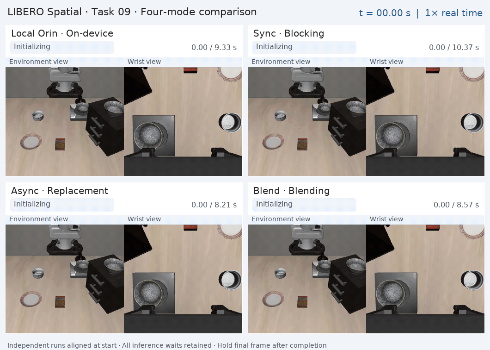

# TurboVLA-SplitInfer

> **Live documentation: [splitinfer.wendiann.cn](https://splitinfer.wendiann.cn/)**
>
> Architecture, collaborative inference, device deployment and measured results.

A two-device inference framework for embodied **vision-language-action (VLA)** models, built on pretrained TurboVLA and evaluated in LIBERO. **Orin handles simulation, observation preprocessing, compression and action execution; Thor runs the complete neural network.** The system supports local baselines and three remote modes: synchronous inference, asynchronous replacement and asynchronous blending.

Target hardware: **Jetson Orin Nano 8GB + Jetson Thor 128GB**. The split lies between normalized tensors and neural inference. DINOv3, BERT, vision-language interaction and the action decoder all run on Thor. **Async maps to the CLI name `replace`.**

**Online guides:** [Architecture](https://splitinfer.wendiann.cn/guide/architecture.html) · [Scheduling](https://splitinfer.wendiann.cn/guide/scheduling.html) · [Deployment](https://splitinfer.wendiann.cn/guide/deployment.html) · [Benchmarks](https://splitinfer.wendiann.cn/guide/benchmark-results.html) · [Code coverage](https://splitinfer.wendiann.cn/guide/completeness.html)

**Local documentation:** [Source and setup](docs-site/README.md). Run `npm ci && npm run dev` in `docs-site/`; `npm run build` produces a deployable static site.

## Split-inference framework


[Full-resolution framework](assets/diagrams/split-inference/framework-flat.png) · [Pipeline overview](assets/diagrams/split-inference/pipeline-flat.png) · [Editable PowerPoint, 2 slides](assets/diagrams/split-inference/turbovla-diagrams-editable.pptx)

## Three collaborative inference modes

The illustrations share a schematic timeline with chunk length 12, replanning every four control steps and a three-step blending window. These are scheduling illustrations, not measured timings. See [scheduling details](docs-site/guide/scheduling.md).

### Async · asynchronous replacement (`replace`)

Thor predicts the next chunk while Orin executes available actions. On arrival, trim the stale prefix using executed control steps and replace the future timeline.


### Blend · asynchronous blending

Use the same asynchronous alignment, gradually increasing the new-action weight across the overlapping window. Blend only pose commands; keep gripper commands discrete.


### Sync · synchronous inference

After exhausting a chunk, request the next one and pause control steps until it arrives.


[Combined animation](assets/diagrams/split-inference/animations/pipeline-comparison.gif) · Still frames: [Async](assets/diagrams/split-inference/animations/pipeline-async-poster.png) / [Blend](assets/diagrams/split-inference/animations/pipeline-blend-poster.png) / [Sync](assets/diagrams/split-inference/animations/pipeline-sync-poster.png)

## Hardware deployment

The project is deployed on two physical devices, **Jetson Orin Nano 8GB and Jetson Thor 128GB**, for observation/control and complete-model inference respectively.

| Jetson Orin Nano · 8GB | Jetson Thor · 128GB |
| --- | --- |
|  |  |
| Observation preprocessing, request scheduling and LIBERO execution | DINOv3, BERT, V–L interaction, ACT and action denormalization |

Photographs were cleaned through the DDS image API to remove background clutter and surface marks. Originals: [Orin](assets/realpics/orin.jpg) · [Thor](assets/realpics/Thor.jpg). Performance is established by recorded evaluations.

## Simulation in action

**Local Orin / Sync / Async / Blend**, shown in a 2×2 cabinet-to-plate task comparison. Environment and wrist views are preserved. Independent runs are aligned at their start and replayed at **1× wall-clock speed**, with execution, inference-wait, background-inference and success indicators.

[](assets/simulation/libero-four-mode-realtime.gif)

## Environment and resources

Use Python 3.10. The upstream LIBERO reference environment uses PyTorch 2.3.1, torchvision 0.18.1, Transformers 4.56, TensorFlow 2.20 and TFDS 4.9.3. Current dependency ranges are defined in [pyproject.toml](pyproject.toml).

| Area | Dependencies |
| --- | --- |
| Model execution | CUDA PyTorch ≥2.3, compatible torchvision, Transformers ≥4.56 and <5, timm ≥1.0 |
| Utilities | NumPy ≥1.26 and <2, Pillow ≥10, tqdm ≥4.66, PyYAML |
| LIBERO simulation/video | robosuite 1.4.1, MuJoCo/OpenGL, bddl, gym, cloudpickle, easydict, imageio[ffmpeg] ≥2.34 |
| Training/data | h5py ≥3.10, TensorFlow ≥2.20, TFDS ≥4.9; included in the current `libero` extra |
| Fast transport codecs | lz4 ≥4.3 and <5, zstandard ≥0.22 and <1; included in `split` |

**Use NVIDIA PyTorch builds matching each Jetson's JetPack/CUDA environment.** Follow [NVIDIA's Jetson instructions](https://docs.nvidia.com/deeplearning/frameworks/install-pytorch-jetson-platform/index.html); do not substitute x86_64 CUDA wheels.

```bash
conda create -n turbovla-libero python=3.10 -y
conda activate turbovla-libero
# Install device-compatible torch and torchvision first.
python -m pip install -e '.[libero,split]' PyYAML
git clone https://github.com/Lifelong-Robot-Learning/LIBERO.git ../LIBERO
python -m pip install -e ../LIBERO
python -m pip check
```

Reuse an existing LIBERO checkout when available. Its older requirements pin NumPy and Transformers versions that differ from this project; follow the compatible environment above.

```bash
python -c "import numpy as np, torch, torchvision, transformers; print('torch:', torch.__version__, 'torchvision:', torchvision.__version__, 'transformers:', transformers.__version__); print('CUDA:', torch.cuda.is_available(), 'BF16:', torch.cuda.is_bf16_supported()); print(torch.from_numpy(np.zeros(1, dtype=np.float32)).numpy())"
```

Thor, or a device running the local baseline, needs these resources; remote Orin does not need model weights:

| Resource | Purpose |
| --- | --- |
| [TurboVLA checkpoint](https://huggingface.co/H-EmbodVis/TurboVLA) | Complete LIBERO model, normally `pretrained/TurboVLA/checkpoints/libero/turbovla_libero.pth` |
| [DINOv3 ViT-B](https://huggingface.co/facebook/dinov3-vitb16-pretrain-lvd1689m) | Vision configuration, preprocessing and model resources |
| [BERT base uncased](https://huggingface.co/google-bert/bert-base-uncased) | Text encoder and tokenizer |
| [GroundingDINO Swin-T OGC](https://github.com/IDEA-Research/GroundingDINO) | Initialization in the upstream training recipe; unnecessary for evaluation with a complete checkpoint |

Online evaluation needs LIBERO BDDL, initial states and assets, not demonstration datasets.

## Run

Execute from the repository root in the appropriate device environment:

```bash
# Thor: start the model service (default port 8765).
bash scripts/libero/serve_thor.sh

# Orin: check configuration/service, then run all three modes.
bash scripts/libero/run_async_benchmark.sh --preflight
bash scripts/libero/run_async_benchmark.sh

# Single-task runs; replace is the CLI name for Async.
bash scripts/libero/run_async_benchmark.sh --task_ids 0 --modes sync
bash scripts/libero/run_async_benchmark.sh --task_ids 0 --modes replace
bash scripts/libero/run_async_benchmark.sh --task_ids 0 --modes blend

# Orin or Thor: complete-model local baseline.
bash scripts/libero/run_local_benchmark.sh
```

Defaults: 12-step chunks, replanning every four control steps, a three-step blending window and at most one request in flight. Blend uses new-action weights `1/3 → 2/3 → 1` on the first six relative-pose dimensions with discrete gripper switching. Empty buffers produce zero arm increments and retain the gripper command, counted as `hold_steps`. This is inference-time blending, not an RTC implementation.

## Configuration

- **Remote benchmark:** [async_benchmark.yaml](experiments/libero/configs/async_benchmark.yaml). Resource paths, Thor URL, tasks, precision, scheduling, videos and initial-call filtering.
- **Local benchmark:** [local_benchmark.yaml](experiments/libero/configs/local_benchmark.yaml). Also requires checkpoint, DINOv3, BERT and statistics paths.
- **Thor service:** [serve_thor.sh](scripts/libero/serve_thor.sh). Override `DINOV3_PATH`, `BERT_PATH`, `THOR_HOST`, `THOR_PORT` and `--ckpt_path` as needed.

Defaults are all `libero_spatial` tasks, one trial per task/mode, seed 7, BF16 and EGL. Use `task_ids: "0,1,2"` for a subset. Precision and chunk_size must match Thor. Statistics: [libero_all4_stats.json](experiments/libero/configs/libero_all4_stats.json), key `libero_all4_no_noops`.

Paths are relative to the repository root. CLI options take precedence; `THOR_URL`, `LIBERO_ROOT` and `TURBOVLA_PYTHON` support environment overrides. Copy settings to ignored `*.local.yaml` files and select them with `--config`. Each run receives its own LIBERO path configuration.

## Key implementation

| Location | Responsibility |
| --- | --- |
| [benchmark_async.py](scripts/libero/benchmark_async.py) | Remote entry point, configuration, mode comparison and reports |
| [async_rollout.py](turbovla/evaluation/async_rollout.py) | `run_episode()`: background requests, execution and empty buffers; `ActionTimeline.merge()`: alignment/replacement/blending; `save_realtime_video()`: wall-clock playback |
| [split/](turbovla/split/) | Orin client, Thor server and lossless tensor protocol |
| [benchmark_local.py](scripts/libero/benchmark_local.py) / [benchmark_common.py](scripts/libero/benchmark_common.py) | Local evaluation, shared configuration, hardware identification and statistics |
| [suite_policy.py](turbovla/evaluation/suite_policy.py) | LIBERO adapter and action denormalization |
| [action_head.py](turbovla/models/action_head.py) | ACT-style decoder producing complete action chunks |

## Results and validation

<!-- BENCHMARK_RESULTS_START -->

**LIBERO Spatial · Measured comparison**

9 matched successful cases · Excluded task/episode: 4/0. Recomputed from existing records, without rerunning evaluation. Matched case counts are not overall success rates.

| Device / mode | Matched cases | Executed steps | Total time / s | Mean response¹ / ms | Response p95¹ / ms | Control interval p95 / ms | Hold steps |
| --- | ---: | ---: | ---: | ---: | ---: | ---: | ---: |
| Orin local | 9 | 868 | 71.40 | 125.01 | 127.70 | 192.13 | 0 |
| Thor local | 9 | 898 | 26.95 | 31.15 | 33.36 | 55.83 | 0 |
| Sync | 9 | 902 | 74.76 | 134.03 | 285.30 | 167.40 | 0 |
| Async / replace | 9 | 900 | 65.72 | 113.14 | 235.42 | 82.33 | 3 |
| Blend | 9 | 893 | 65.94 | 116.92 | 226.76 | 81.35 | 0 |

¹ See the data page for initial-call filtering. `—` means not recorded. Response latency is per action chunk and includes preprocessing, transport and server inference in remote mode. Total time retains initial inference waits.


[Detailed results and methodology](docs-site/guide/benchmark-results.md) · [JSON data](reports/evaluation/latest.json) · [CSV summary](reports/evaluation/summary.csv)

**Latency breakdown**


Local bars show complete calls; remote bars show stage means that sum to mean response latency. HTTP/transport includes receive waits and system overhead.

[Download SVG](assets/benchmarks/libero-spatial-common-success-stages.svg) · [Download PNG](assets/benchmarks/libero-spatial-common-success-stages.png)

<!-- BENCHMARK_RESULTS_END -->

Run outputs are stored under `outputs/evaluation/local/` and `outputs/evaluation/async/`. Remote records include raw JSON, summaries, per-request/per-step CSV, videos, comparison files and metadata. Regular videos replay control steps at 20 FPS; `*_realtime.mp4` retains actual waits. The 20 Hz remote configuration is an upper bound, not a guaranteed achieved rate.

```bash
PYTHONPATH=third_party/vla_adapter:. python -m unittest discover -s tests -v
```

[benchmark_transport.py](scripts/libero/benchmark_transport.py) compares codecs using fixed observations; [check_split_parity.py](scripts/libero/check_split_parity.py) checks direct/HTTP output parity; [summarize_split.py](scripts/libero/summarize_split.py) reconstructs legacy synchronous reports. See [validation](docs-site/guide/validation.md) for metric definitions and device checks.

## System capabilities

| Dimension | Capability |
| --- | --- |
| **Functionality** | Closes the observation–inference–execution loop with synchronous, asynchronous replacement and asynchronous blending modes. |
| **Responsiveness** | Overlaps inference with action execution to reduce the impact of prediction waits on control updates. |
| **Practicality** | Places the complete model on Thor, reducing the model memory and compute required on the Orin control device. |
| **Stability** | Aligns action timestamps, discards stale actions and handles empty buffers to limit disruptions caused by response latency. |
| **Safety** | Validates messages, action values and response identity to reduce the risk of invalid or mismatched data entering the control loop. |
| **Consistency** | Uses a common model interface and action semantics for checking local/remote outputs and comparing scheduling modes. |
| **Reproducibility** | Preserves configurations, random seeds and raw records for repeatable tasks and verifiable comparisons. |
| **Observability** | Records inference, communication, control timings and buffer state to locate bottlenecks and assess scheduling. |
| **Maintainability** | Separates model, transport and scheduling responsibilities for independent debugging and iteration. |
| **Extensibility** | Provides model and task interfaces for extending compression strategies, scheduling configurations and task scenarios. |

The inference service runs on a controlled experimental network; the static documentation is hosted independently. See [operating conditions](docs-site/guide/capabilities.md) for networking and physical-device requirements.

## Upstream reference

[TurboVLA: Real-Time Vision-Language-Action Model at 32 Hz on an RTX 4090 with <1 GB VRAM](https://arxiv.org/abs/2607.27205). arXiv:2607.27205, 2026.

[Upstream code](https://github.com/H-EmbodVis/TurboVLA) · [Project license](LICENSE) · [LIBERO adapter attribution](third_party/licenses/VLA-Adapter.txt)
