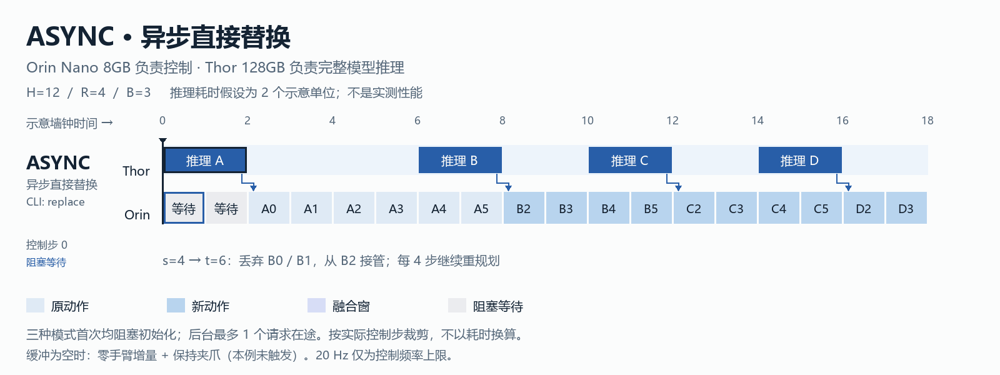
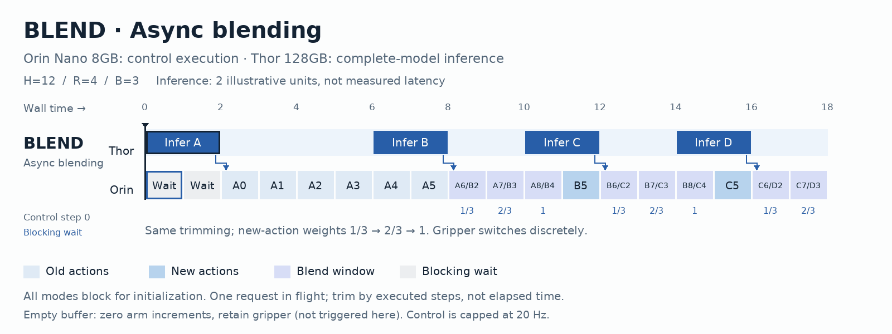
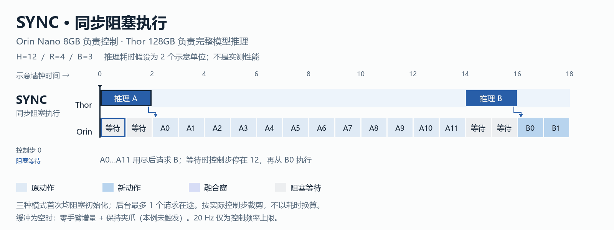
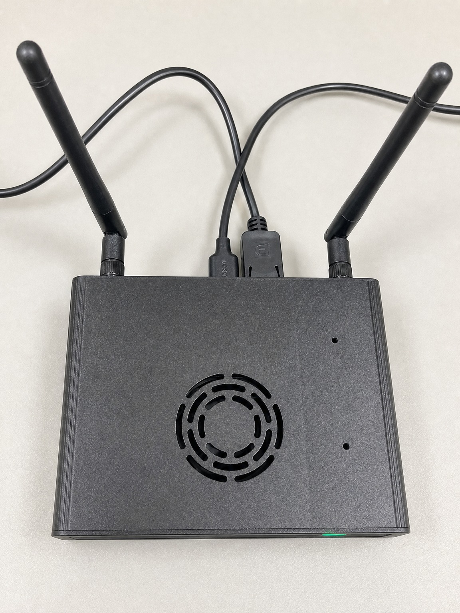
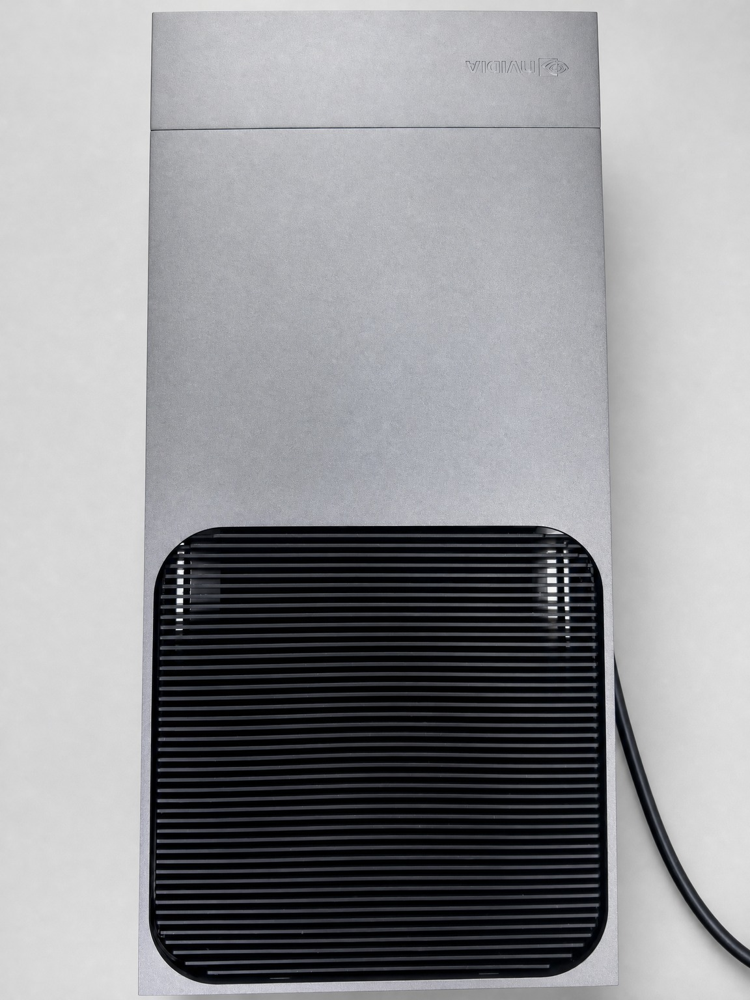
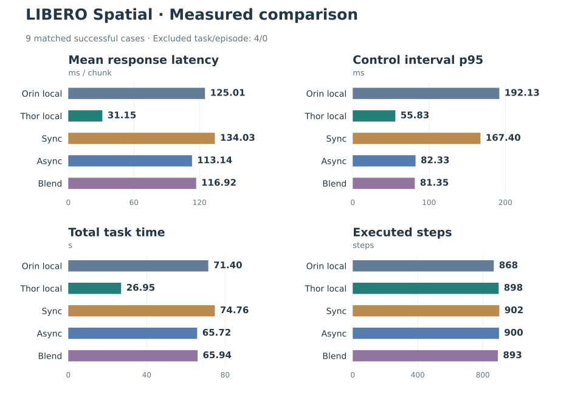
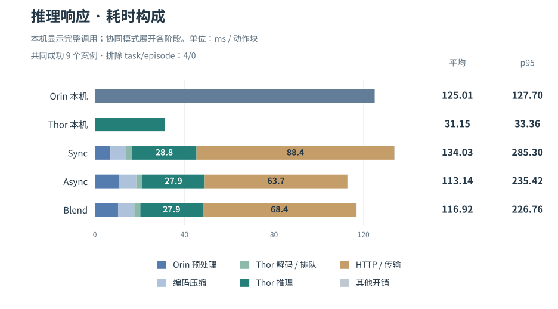

# TurboVLA-SplitInfer

> **在线文档已上线：[splitinfer.wendiann.cn](https://splitinfer.wendiann.cn/)**
>
> 查看系统架构、协同推理策略、设备部署指南与最新实测结果。

基于预训练 TurboVLA 的 LIBERO 双设备推理：**Orin 负责仿真、图像/状态预处理和压缩，Thor 负责全部神经网络推理**，动作返回 Orin 执行。支持本机基准，以及同步、异步替换、异步融合三种远程模式。

目标设备为 **Jetson Orin Nano 8GB + Jetson Thor 128GB**。拆分边界在归一化张量与神经网络之间，DINOv3、BERT、视觉语言交互和动作解码器均在 Thor。文档与图稿中的 **Async 对应 CLI 的 `replace`**。

**在线导航**：[系统架构](https://splitinfer.wendiann.cn/guide/architecture.html) · [协同推理](https://splitinfer.wendiann.cn/guide/scheduling.html) · [设备部署](https://splitinfer.wendiann.cn/guide/deployment.html) · [实测数据](https://splitinfer.wendiann.cn/guide/benchmark-results.html) · [代码完整性](https://splitinfer.wendiann.cn/guide/completeness.html)。

**文档开发**：[源码与本地启动](docs-site/README.md)。在 `docs-site/` 执行 `npm ci && npm run dev`；`npm run build` 生成可自行部署的静态网站。

## 拆分推理框架


[查看框架原图](assets/diagrams/split-inference/framework-flat.png) · [流水线静态总览](assets/diagrams/split-inference/pipeline-flat.png) · [两页可编辑 PPT](assets/diagrams/split-inference/turbovla-diagrams-editable.pptx)

## 三种协同推理模式

以下动图使用统一示意时间轴，展示 Thor 推理与 Orin 执行的协同过程。动作块长度为 12，异步重规划间隔为 4 个控制步，融合窗口为 3 步。详细规则见[调度说明](docs-site/guide/scheduling.md)。

### Async · 异步替换（CLI：`replace`）

Orin 执行已有动作时，Thor 在后台预测下一动作块；返回后按已执行控制步裁掉过期前缀，替换未来动作。



### Blend · 异步融合

沿用异步推理与时间对齐，在新旧动作重叠窗口内逐步增加新动作权重，使动作衔接更平滑。



### Sync · 同步推理

执行完当前动作块后，阻塞请求下一动作块；等待期间暂停推进控制步，收到结果后继续执行。



[三模式对照动图](assets/diagrams/split-inference/animations/pipeline-comparison.gif) · 静态帧：[Async](assets/diagrams/split-inference/animations/pipeline-async-poster.png) / [Blend](assets/diagrams/split-inference/animations/pipeline-blend-poster.png) / [Sync](assets/diagrams/split-inference/animations/pipeline-sync-poster.png)

## 实物部署

项目已在 **Jetson Orin Nano 8GB + Jetson Thor 128GB** 两台实体设备上部署，分别承担观测与控制、完整模型推理。

| Jetson Orin Nano · 8GB | Jetson Thor · 128GB |
| --- | --- |
|  |  |
| 观测预处理、请求调度、LIBERO 动作执行 | DINOv3、BERT、V–L 交互、ACT 与动作反归一化 |

图片经 DDS 图像接口清理背景杂物与表面污点；原始实拍保留：[Orin](assets/realpics/orin.jpg) · [Thor](assets/realpics/Thor.jpg)。照片展示实际设备，成功率、延迟与稳定性以运行记录为准。

## 环境与资源

推荐 Python 3.10。原始 LIBERO 参考环境为 PyTorch 2.3.1、torchvision 0.18.1、Transformers 4.56、TensorFlow 2.20、TFDS 4.9.3；当前依赖范围以 [pyproject.toml](pyproject.toml) 为准：

| 类别 | 前置依赖 |
| --- | --- |
| 模型运行 | CUDA PyTorch ≥2.3、与其匹配的 torchvision；Transformers ≥4.56 且 <5、timm ≥1.0 |
| 基础工具 | NumPy ≥1.26 且 <2、Pillow ≥10、tqdm ≥4.66、PyYAML |
| LIBERO 仿真与视频 | robosuite 1.4.1、MuJoCo / PyOpenGL、bddl、gym、cloudpickle、easydict、imageio[ffmpeg] ≥2.34；EGL 渲染需要可用的 GPU 驱动 |
| 训练与数据处理 | h5py ≥3.10、TensorFlow ≥2.20、tensorflow-datasets ≥4.9；当前 `libero` 安装项包含这些依赖 |
| 双设备快速压缩 | lz4 ≥4.3 且 <5、zstandard ≥0.22 且 <1，由 `split` 安装项提供 |

先创建环境并安装配套的 PyTorch / torchvision。**Jetson Orin、Thor 应使用匹配各自 JetPack/CUDA 的 NVIDIA 构建**，可参考 [Jetson PyTorch 安装说明](https://docs.nvidia.com/deeplearning/frameworks/install-pytorch-jetson-platform/index.html)；已有可用环境可直接复用。

```bash
conda create -n turbovla-libero python=3.10 -y
conda activate turbovla-libero

# 仅供普通 x86_64 Linux 的原始 CUDA 12.1 参考环境使用；Jetson 按上面的设备说明安装
python -m pip install torch==2.3.1 torchvision==0.18.1 --index-url https://download.pytorch.org/whl/cu121
```

PyTorch 安装完成后，在仓库根目录安装项目和 [LIBERO](https://github.com/Lifelong-Robot-Learning/LIBERO)：

```bash
python -m pip install -e '.[libero,split]' PyYAML
git clone https://github.com/Lifelong-Robot-Learning/LIBERO.git ../LIBERO
python -m pip install -e ../LIBERO
python -m pip check
```

已有 LIBERO 目录时跳过 clone，并替换安装路径。LIBERO 的旧 `requirements.txt` 固定了 NumPy 1.22.4、Transformers 4.21.1 等版本，与当前 TurboVLA 依赖冲突，安装时沿用上表版本。安装后可检查 PyTorch/NumPy 转换及 CUDA：

```bash
python -c "import numpy as np, torch, torchvision, transformers; print('torch:', torch.__version__, 'torchvision:', torchvision.__version__, 'transformers:', transformers.__version__); print('CUDA:', torch.cuda.is_available(), 'BF16:', torch.cuda.is_bf16_supported()); print(torch.from_numpy(np.zeros(1, dtype=np.float32)).numpy())"
```

Thor 或本机推理设备还需以下模型资源；远程模式的 Orin 无需这些权重：

| 资源 | 用途 |
| --- | --- |
| [TurboVLA checkpoint](https://huggingface.co/H-EmbodVis/TurboVLA) | `pretrained/TurboVLA/checkpoints/libero/turbovla_libero.pth` |
| [DINOv3 ViT-B](https://huggingface.co/facebook/dinov3-vitb16-pretrain-lvd1689m) | 视觉编码器配置、预处理参数及模型资源 |
| [BERT base uncased](https://huggingface.co/google-bert/bert-base-uncased) | 文本编码器与 tokenizer 资源 |
| [GroundingDINO Swin-T OGC](https://github.com/IDEA-Research/GroundingDINO) | 原始训练配方的初始化权重；加载完整 TurboVLA checkpoint 评测时不需要额外提供 |

模型路径在下方配置中指定。在线评测需要 LIBERO 的 BDDL、初始状态和 assets，不要求下载演示数据。

## 运行

在仓库根目录、对应设备的 Python 环境中执行：

```bash
# Thor：启动模型服务，默认端口 8765
bash scripts/libero/serve_thor.sh

# Orin：检查配置和服务，再运行三种模式
bash scripts/libero/run_async_benchmark.sh --preflight
bash scripts/libero/run_async_benchmark.sh

# 单任务、指定模式；replace 即异步直接替换
bash scripts/libero/run_async_benchmark.sh --task_ids 0 --modes sync
bash scripts/libero/run_async_benchmark.sh --task_ids 0 --modes replace
bash scripts/libero/run_async_benchmark.sh --task_ids 0 --modes blend

# Orin 或 Thor：全部模型在当前设备推理的本机基准
bash scripts/libero/run_local_benchmark.sh
```

| 模式 | 调度方式 |
| --- | --- |
| `sync` | 执行完当前动作块，再阻塞请求下一块 |
| `replace` | 执行期间后台预测，按已执行步数裁掉过期前缀，替换未来动作 |
| `blend` | 同样后台预测和对齐，在新旧动作重叠窗口内渐变切换 |

默认动作块 12 步、每 4 步尝试重规划、融合窗口 3 步，最多一个请求在途。融合仅处理前 6 维相对位姿指令，新动作权重为 `1/3 → 2/3 → 1`；夹爪保持离散切换。缓冲区为空时保持夹爪并执行零手臂增量，记录为 `hold_steps`。这是推理阶段的融合实验，不是 RTC 实现。

## 配置

- **远程评测**：[async_benchmark.yaml](experiments/libero/configs/async_benchmark.yaml)。`paths` / `libero_paths` 配置 LIBERO 代码、资源与数据目录；`evaluation` 配置 Thor URL、任务、精度、视频等；`experiment` 配置模式、重规划和融合窗口；`benchmark` 配置输出目录及首次调用筛选数。
- **本机评测**：[local_benchmark.yaml](experiments/libero/configs/local_benchmark.yaml)。另需配置 checkpoint、DINOv3、BERT 和统计文件路径。
- **Thor 服务**：[serve_thor.sh](scripts/libero/serve_thor.sh)。默认 checkpoint 为 `pretrained/TurboVLA/checkpoints/libero/turbovla_libero.pth`；`DINOV3_PATH`、`BERT_PATH`、`THOR_HOST`、`THOR_PORT` 可覆盖模型路径和监听地址，`--ckpt_path` 可覆盖权重路径。

默认 `libero_spatial` 全部任务、每任务每模式 1 次、seed 7、BF16、EGL。`task_ids: "0,1,2"` 可缩小测试范围。`chunk_size` 和精度须与 Thor 服务一致。统计文件为 [libero_all4_stats.json](experiments/libero/configs/libero_all4_stats.json)，key 为 `libero_all4_no_noops`。

相对路径以仓库根目录为准，命令行参数优先。`THOR_URL` / `LIBERO_ROOT` 可覆盖远程配置，`TURBOVLA_PYTHON` 可指定脚本解释器。每次运行生成独立 LIBERO 路径配置。可复制 YAML 为 `*.local.yaml`，通过 `--config` 指定；本机配置被 Git 忽略。

## 关键代码

| 位置 | 职责 |
| --- | --- |
| [scripts/libero/benchmark_async.py](scripts/libero/benchmark_async.py) | 统一远程入口、配置、三模式对比与报告导出 |
| [turbovla/evaluation/async_rollout.py](turbovla/evaluation/async_rollout.py) · `run_episode()` | 后台预测、单请求调度、动作执行与缓冲区耗尽处理 |
| 同文件 · `ActionTimeline.merge()` | 新旧动作按控制步对齐、`replace` 替换、`blend` 融合 |
| 同文件 · `save_realtime_video()` | 按墙钟时间导出，标注等待、后台推理及保持状态 |
| [turbovla/split/](turbovla/split/) | `client.py`：Orin 预处理与请求；`server.py`：Thor 推理；`protocol.py`：张量编码与无损压缩 |
| [scripts/libero/benchmark_local.py](scripts/libero/benchmark_local.py) / [benchmark_common.py](scripts/libero/benchmark_common.py) | 本机评测 / 公共配置、设备识别及统计工具 |
| [turbovla/evaluation/suite_policy.py](turbovla/evaluation/suite_policy.py) | LIBERO 策略适配、动作反归一化 |
| [turbovla/models/action_head.py](turbovla/models/action_head.py) | ACT 风格动作解码器，一次输出完整动作块 |

## 结果与验证

<!-- BENCHMARK_RESULTS_START -->

**LIBERO Spatial · 实测对照**

共同成功 9 个案例 · 排除 task/episode：4/0。使用现有记录重算，未重新评测。共同成功案例数不代表整体成功率。

**Thor 本机：平均推理 31.15 ms/块 · 控制间隔 p95 55.83 ms · 任务总耗时 26.95 s · 共同成功案例 9 个。**

| 设备 / 模式 | 共同成功案例数 | 执行步数 | 任务总耗时 / s | 平均推理响应时间¹ / ms | 推理响应时间 p95¹ / ms | 控制间隔 p95 / ms | hold 步 |
| --- | ---: | ---: | ---: | ---: | ---: | ---: | ---: |
| Orin local | 9 | 868 | 71.40 | 125.01 | 127.70 | 192.13 | 0 |
| Thor local | 9 | 898 | 26.95 | 31.15 | 33.36 | 55.83 | 0 |
| Sync | 9 | 902 | 74.76 | 134.03 | 285.30 | 167.40 | 0 |
| Async / replace | 9 | 900 | 65.72 | 113.14 | 235.42 | 82.33 | 3 |
| Blend | 9 | 893 | 65.94 | 116.92 | 226.76 | 81.35 | 0 |

¹ 每个 episode 的首次调用筛选数见数据页；`—` 表示未记录。推理响应时间按整块动作统计，远程模式包含预处理、传输和服务端推理。任务总耗时仍包含保留回合的首次推理等待。



[详细数据与统计口径](docs-site/guide/benchmark-results.md) · [JSON 数据](reports/evaluation/latest.json) · [CSV 汇总](reports/evaluation/summary.csv)

控制频率及配置见数据页；总耗时包含任务轨迹差异。

**推理耗时构成**



本机显示完整调用，协同模式显示各阶段均值；各段之和等于响应均值。HTTP / 传输包含接收等待与系统开销。

[下载 SVG](assets/benchmarks/libero-spatial-common-success-stages.svg) · [下载 PNG](assets/benchmarks/libero-spatial-common-success-stages.png)

<!-- BENCHMARK_RESULTS_END -->

比较时需结合样本数、成功情况和执行步数，任务总耗时差不能直接视为纯模型加速。缺失指标保留为未记录；具体来源、设备元数据和追加流程见数据页。

后续追加完成的运行目录，再统一生成图表和文档（需要 Matplotlib）：

```bash
python scripts/libero/build_benchmark_report.py add /path/to/completed/run --group new-round --title '新一轮实验'
python scripts/libero/build_benchmark_report.py build
```

在 `reports/evaluation/catalog.json` 的 `featured_group` 指定最新对照后重新生成，README、网站和下载数据会同步更新，详见[数据维护说明](docs-site/guide/benchmark-data.md)。

结果自动按设备和时间戳保存：远程在 `outputs/evaluation/async/`，本机在 `outputs/evaluation/local/`。远程每个模式包含原始 JSON、summary、逐请求/逐控制步 CSV 和视频，另有 comparison 与运行 metadata。

本机入口 `bash scripts/libero/run_local_benchmark.sh` 自动记录逐步时间戳，生成 `_steps.csv`，并在 `_summary.json` 的 `control_intervals.p95_ms` 输出控制间隔 p95。间隔按同一回合内相邻动作开始时间计算，不受首次推理过滤影响；旧记录缺少时间戳时仍为未记录，需重新运行获取。本机执行没有墙钟频率限制，远程对比入口默认限制为 20 Hz，横向比较需注明此差异。

普通视频按控制步以 20 FPS 回放；`*_realtime.mp4` 保留实际等待时间。`filtered_calls` 默认排除每个 episode 的首次请求，原始记录保留。异步重点比较成功率、控制间隔 p95、`hold_steps` 和总用时；推理与执行重叠，不能用总用时减推理耗时推导其他耗时。配置中的 20Hz 是墙钟频率上限，不保证仿真达到该速度。

```bash
PYTHONPATH=third_party/vla_adapter:. python -m unittest discover -s tests -v
```

[benchmark_transport.py](scripts/libero/benchmark_transport.py) 用于固定观测的传输测速；[check_split_parity.py](scripts/libero/check_split_parity.py) 验证直接推理与 HTTP 返回动作一致；[summarize_split.py](scripts/libero/summarize_split.py) 可补算历史同步结果。`outputs/` 内的评测数据、视频、日志和观测文件可以提交 Git；权重、数据集目录和缓存继续忽略。

## 系统能力

系统面向资源受限设备上的视觉语言动作模型部署，通过 Orin 控制执行与 Thor 模型推理的协同分工，支持闭环任务运行、推理调度优化与统一性能评估。

| 维度 | 能力描述 |
| --- | --- |
| **功能性** | 支持观测采集、远程推理与动作执行的完整闭环，提供同步、异步替换和异步融合三种协同模式。 |
| **实时性** | 通过异步推理与动作执行重叠，减少推理等待对控制节拍的影响，提高计算与执行的并行程度。 |
| **实用性** | 将完整模型部署于 Thor，降低 Orin 控制端的模型内存与计算需求，支持异构设备协同部署。 |
| **稳定性** | 通过动作时序对齐、过期动作剔除及缓冲耗尽处理，减轻响应延迟对动作执行连续性的影响。 |
| **安全性** | 校验通信报文、动作数值与响应归属，降低异常数据和错配响应进入控制链路的风险。 |
| **一致性** | 统一模型调用接口与动作语义，为本机推理与远程推理的输出核对、协同模式对比提供共同基准。 |
| **可复现性** | 记录实验配置、随机种子与原始运行数据，支持任务复现、结果复核及跨模式比较。 |
| **可观测性** | 记录推理、通信与控制环节的耗时及缓冲状态，支持性能瓶颈定位与调度效果分析。 |
| **可维护性** | 按模型、传输与调度划分模块职责，降低功能耦合，便于独立调试、故障定位与持续迭代。 |
| **可扩展性** | 通过统一模型接口与任务适配入口，支持压缩策略、调度配置及任务场景的进一步扩展。 |

本地验证：**33 项单元测试通过**，通过 mock / fake policy 与本机 HTTP 核验协议、调度和报告逻辑。设备端按“相同 checkpoint 数值一致性 → 三模式任务对比 → 长时运行与资源监控”组织评测并保存结果。

推理 HTTP 服务部署于受控实验网络，静态文档网站独立部署。跨网络访问与设备安全要求见[系统能力说明](docs-site/guide/capabilities.md)。

## 论文引用

[TurboVLA: Real-Time Vision-Language-Action Model at 32 Hz on an RTX 4090 with <1 GB VRAM](https://arxiv.org/abs/2607.27205). arXiv:2607.27205, 2026.

[上游代码](https://github.com/H-EmbodVis/TurboVLA) · [项目许可证](LICENSE) · [LIBERO 评测适配来源许可](third_party/licenses/VLA-Adapter.txt)
