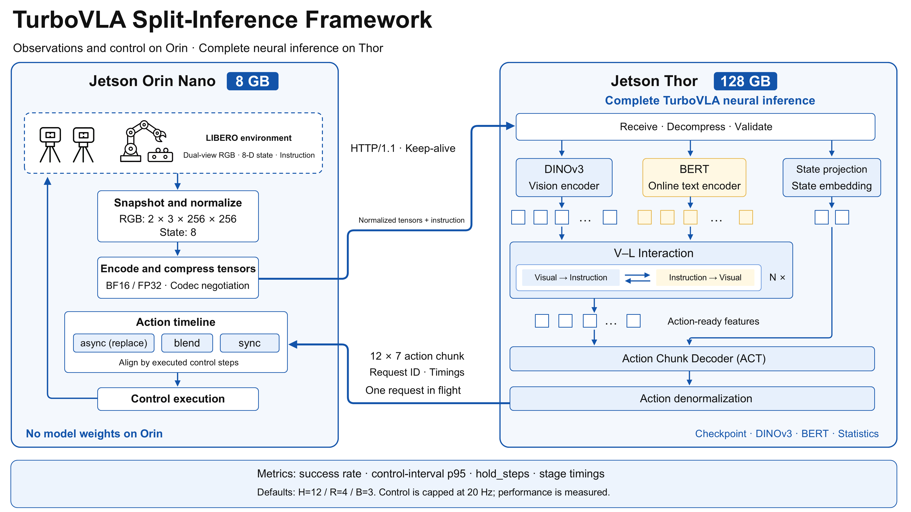

# Two-device architecture

The complete model runs on Thor, leaving Orin Nano's memory for simulation, observations and control. This is a **division of system responsibilities**; neural-network layers are not partitioned across devices.

## Split-inference framework

[Download the editable two-slide PowerPoint](../../assets/diagrams/split-inference/turbovla-diagrams-editable.pptx)

The English diagrams reuse the editable reconstruction of the original DDS-generated artwork: native text, solid fills, continuous arrows and independent icons. Token blocks illustrate structure; actual counts follow the model configuration.

## Data flow

| Stage | Device | Input → output | Implementation |
| --- | --- | --- | --- |
| Observation snapshot | Orin | Two cameras, pose and gripper state → independent copies | `async_rollout.py::submit()` |
| Preprocessing | Orin | 256×256 RGB and 8-D state → normalized tensors | `split/client.py` |
| Encoding | Orin | Tensors and JSON header → losslessly compressed message | `split/protocol.py` |
| Neural inference | Thor | DINOv3 and online BERT → bidirectional V–L interaction → ACT | `models/turbovla.py` |
| State fusion | Thor | 8-D state → state tokens → ACT memory | `models/action_head.py` |
| Action conversion | Thor | Normalized output → relative pose and discrete gripper command | `evaluation/suite_policy.py` |
| Alignment and execution | Orin | Action chunk → control-step timeline → `env.step()` | `evaluation/async_rollout.py` |

## Upstream model

The split system preserves the upstream architecture. Visual and language features interact bidirectionally to produce action-ready features. A separate projection encodes robot state; these tokens join the fused features in the ACT decoder.

The default LIBERO configuration has six interaction layers and three ACT decoder layers. The checkpoint's `model_config` is authoritative. BERT encodes instructions online; frozen parameters do not imply cached offline text features.

## Transport contract

| Payload | split v1 constraint |
| --- | --- |
| Images | `[1, 2, 3, 256, 256]`, transmitted after RGB preprocessing |
| State | `[1, 8]` |
| Precision | Matching `bf16` or `fp32` on both devices |
| Actions | Up to 12 steps, seven finite values per step |
| Request | Four-byte header length, JSON metadata, compressed tensors |
| Response | JSON actions, request/server identifiers, timings and optional allocator metrics |
| Compression | zlib, LZ4 or Zstandard, optionally with byte shuffle |
| Connection | HTTP/1.1 keep-alive; POST requests are not automatically replayed |

Lossless compression preserves the bit pattern of tensors **at the selected precision**. Converting FP32 to BF16 is not itself lossless.

## Execution threads

Orin's main thread advances the environment. One background worker handles preprocessing, compression and remote requests, with at most one request in flight. Thor serializes model access with a lock. Asynchrony overlaps the request pipeline with control execution; it does not run concurrent model requests on Thor.

## Resource accounting

The 8 GB and 128 GB labels describe device capacity, not measured model usage. PyTorch allocator peaks exclude parts of Jetson's shared memory and simulation/system allocations. Record device-level resource measurements alongside allocator statistics.
