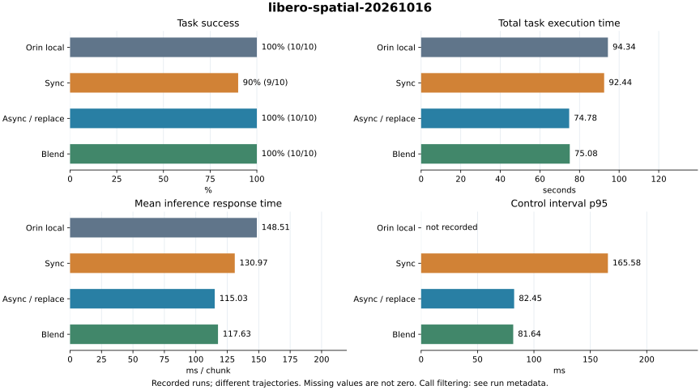

# 实测数据

数据来自已完成的运行记录；下表与图由同一份可追加的数据目录生成。Async 对应 CLI 的 `replace`。

<BenchmarkDashboard />

## 静态对照与下载

¹ 推理响应时间的均值和 p95 均按每个 episode 排除前 N 次调用后汇总；N 见来源表。推理响应时间是从发起策略调用到收到整块动作的耗时；远程模式包含预处理、传输和服务端推理，不是每步耗时。`—` 表示原记录缺失。

[下载结构化数据](../../reports/evaluation/catalog.json) · [下载汇总 CSV](../../reports/evaluation/summary.csv)

## LIBERO Spatial · 2026-10-16

| 设备 / 模式 | 成功 | 执行步数 | 任务总耗时 / s | 平均推理响应时间¹ / ms | 推理响应时间 p95¹ / ms | 控制间隔 p95 / ms | hold 步 |
| --- | ---: | ---: | ---: | ---: | ---: | ---: | ---: |
| Orin local | 10/10 | 1002 | 94.34 | 148.51 | 189.49 | — | — |
| Sync | 9/10 | 1122 | 92.44 | 130.97 | 284.81 | 165.58 | 0 |
| Async / replace | 10/10 | 1026 | 74.78 | 115.03 | 241.70 | 82.45 | 3 |
| Blend | 10/10 | 1021 | 75.08 | 117.63 | 230.05 | 81.64 | 0 |

- 10 个任务各 1 次，seed 7、BF16、chunk 12；远程重规划间隔 4 步、融合窗口 3 步、额外延迟 0。
- Sync 在 task 4 失败，其余任务成功；Async 和 Blend 各 10/10 成功。总时间差含轨迹和完成步数变化。
- 本组只有 Orin 本机数据，尚无 Thor 本机独立运行。旧本机记录缺少控制时间戳，相关指标标为未记录。
- 本机与远程来自不同代码提交和运行时刻；本机未记录 checkpoint SHA-256，权重一致性不能仅凭文件名确认。
- 板卡 metadata 报告 Orin NX Engineering Reference Developer Kit，与项目 Orin Nano 标注存在差异；本页用 Orin 泛称并保留原始值。

### 调度与调用明细

| 模式 | 调用总数 / 过滤后 | 首次推理平均响应时间 / ms | 首段后阻塞 / s | 推理与 env.step 重叠比例 | drain / s | 指令变化 L2 p95 |
| --- | ---: | ---: | ---: | ---: | ---: | ---: |
| Orin local | 88 / 78 | 627.23 | — | — | — | — |
| Sync | 97 / 87 | 167.03 | 11.452 | 0.00 | 0.005 | 0.205 |
| Async / replace | 255 / 245 | 120.76 | 0.000 | 94.19 | 0.013 | 0.207 |
| Blend | 258 / 248 | 136.92 | 0.000 | 93.84 | 0.077 | 0.198 |

重叠比例单位为 %；L2 是相邻六维相对指令差值，混合了平移/旋转单位，不是物理 jerk。

### 远程调用分阶段均值（过滤后，ms）

| 模式 | Orin 预处理 | 编码/压缩 | 往返 | Thor 推理与动作转换 | HTTP/传输残差 |
| --- | ---: | ---: | ---: | ---: | ---: |
| Sync | 6.98 | 6.79 | 116.95 | 28.75 | 85.49 |
| Async / replace | 11.14 | 7.54 | 96.03 | 27.94 | 65.41 |
| Blend | 10.35 | 7.29 | 99.68 | 27.84 | 69.17 |

往返包含 Thor 处理，传输残差含 HTTP/响应开销；阶段不可全部相加。

### 数据来源

| 来源运行 | 配置 | 每回合排除调用数 |
| --- | --- | ---: |
| `orin_libero_spatial_bf16_20261016T211904_081157+0800` | libero_spatial / bf16 / seed 7 / chunk 12 | 1 |
| `orin_to_thor_async_libero_spatial_20261016T224546_700348+0800` | libero_spatial / bf16 / seed 7 / chunk 12 | 1 |

### 逐任务结果

| 模式 | task ID | episode | 成功 | 步数 | 任务耗时 / s | hold 步 |
| --- | ---: | ---: | --- | ---: | ---: | ---: |
| Orin local | 0 | 0 | 是 | 76 | 9.06 | — |
| Orin local | 1 | 0 | 是 | 111 | 9.29 | — |
| Orin local | 2 | 0 | 是 | 90 | 8.56 | — |
| Orin local | 3 | 0 | 是 | 80 | 10.05 | — |
| Orin local | 4 | 0 | 是 | 134 | 14.14 | — |
| Orin local | 5 | 0 | 是 | 95 | 8.25 | — |
| Orin local | 6 | 0 | 是 | 100 | 8.71 | — |
| Orin local | 7 | 0 | 是 | 107 | 9.29 | — |
| Orin local | 8 | 0 | 是 | 96 | 7.52 | — |
| Orin local | 9 | 0 | 是 | 113 | 9.47 | — |
| Sync | 0 | 0 | 是 | 80 | 6.30 | 0 |
| Sync | 1 | 0 | 是 | 114 | 8.90 | 0 |
| Sync | 2 | 0 | 是 | 96 | 7.78 | 0 |
| Sync | 3 | 0 | 是 | 86 | 7.53 | 0 |
| Sync | 4 | 0 | 否 | 220 | 17.68 | 0 |
| Sync | 5 | 0 | 是 | 96 | 7.77 | 0 |
| Sync | 6 | 0 | 是 | 108 | 9.15 | 0 |
| Sync | 7 | 0 | 是 | 112 | 9.74 | 0 |
| Sync | 8 | 0 | 是 | 94 | 7.22 | 0 |
| Sync | 9 | 0 | 是 | 116 | 10.37 | 0 |
| Async / replace | 0 | 0 | 是 | 79 | 5.43 | 0 |
| Async / replace | 1 | 0 | 是 | 113 | 8.18 | 0 |
| Async / replace | 2 | 0 | 是 | 99 | 7.04 | 0 |
| Async / replace | 3 | 0 | 是 | 90 | 6.51 | 0 |
| Async / replace | 4 | 0 | 是 | 126 | 9.06 | 0 |
| Async / replace | 5 | 0 | 是 | 90 | 6.56 | 0 |
| Async / replace | 6 | 0 | 是 | 104 | 8.05 | 0 |
| Async / replace | 7 | 0 | 是 | 112 | 8.43 | 3 |
| Async / replace | 8 | 0 | 是 | 104 | 7.30 | 0 |
| Async / replace | 9 | 0 | 是 | 109 | 8.21 | 0 |
| Blend | 0 | 0 | 是 | 82 | 5.98 | 0 |
| Blend | 1 | 0 | 是 | 107 | 7.54 | 0 |
| Blend | 2 | 0 | 是 | 97 | 6.71 | 0 |
| Blend | 3 | 0 | 是 | 88 | 6.43 | 0 |
| Blend | 4 | 0 | 是 | 128 | 9.14 | 0 |
| Blend | 5 | 0 | 是 | 94 | 7.09 | 0 |
| Blend | 6 | 0 | 是 | 105 | 7.95 | 0 |
| Blend | 7 | 0 | 是 | 113 | 8.93 | 0 |
| Blend | 8 | 0 | 是 | 96 | 6.74 | 0 |
| Blend | 9 | 0 | 是 | 111 | 8.57 | 0 |

## 口径与追加方法

见[数据维护说明](./benchmark-data.md)。每组保留独立运行和逐任务结果，不自动合并不同 seed、任务集、设备或延迟设置。原始文件仍位于忽略提交的 `outputs/`，公开目录记录来源文件名及 SHA-256，重建网页无需访问设备上的原始文件。
