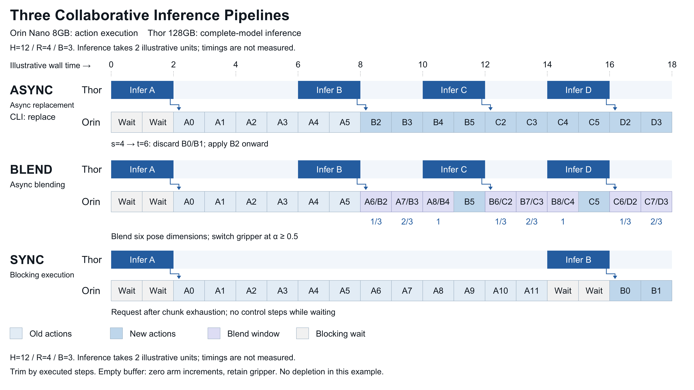

# Sync / Blend / Async

**Async** denotes asynchronous replacement in the website and figures. Its CLI name is **`replace`**. Blend uses the same asynchronous scheduler with a different action-merging rule.

## Pipeline overview



[Download the editable two-slide PowerPoint](../../assets/diagrams/split-inference/turbovla-diagrams-editable.pptx)

The diagram uses editable native objects. The animations follow the same deterministic scheduling sequence. Their time units are illustrative, not measured latency.

<TimelineDemo />

## Pipeline animations

<PipelineAnimation />

<div class="github-only">

**Async: replacement**


**Blend: overlapping actions**


**Sync: blocking inference**


[Three-mode animation](../../assets/diagrams/split-inference/animations/pipeline-comparison.gif)

</div>

Blue inference blocks run on Thor; actions execute on Orin. All rows share an illustrative wall-clock axis. Sync does not advance control steps while waiting; Async and Blend continue using available actions. The default is `H=12 / R=4 / B=3`; the animation includes repeated replanning.

## Shared rules

- Block on the first prediction to initialize the action buffer.
- Use chunks of `H=12`, attempt asynchronous replanning every `R=4` executed control steps, and blend over up to `B=3` steps.
- Allow at most one request in flight. Snapshot observations to avoid reused image buffers.
- Align actions by **executed control steps**, not by dividing HTTP latency by 50 ms.
- Limit control to 20 Hz without skipping steps or catching up when simulation is slow.

## Sync: blocking baseline

After exhausting a chunk, capture a new observation and request the next chunk. No `env.step()` is executed during the wait. Use wall-clock videos to retain these pauses.

```bash
bash scripts/libero/run_async_benchmark.sh --modes sync
```

## Async: trim and replace

Continue executing the old chunk during prediction. If observation step `s` produces a response merged at control step `t`, discard the first `min(t-s, H)` actions. Replace the entire old future timeline, including its tail, with the remaining new actions.

For a request sampled at step 4 and merged at step 6, `B0` and `B1` are stale; execution starts at `B2`. If `t-s >= H`, discard the whole new chunk while retaining any valid old actions.

```bash
bash scripts/libero/run_async_benchmark.sh --modes replace
```

## Blend: transition over the overlap

Apply the same stale-prefix trimming, then find the contiguous overlap `O`, capped by `blend_steps`. At overlapping position `i`, use `alpha=(i+1)/O`:

```text
arm = (1 - alpha) * old_arm + alpha * new_arm
gripper = new_gripper if alpha >= 0.5 else old_gripper
```

A three-step overlap uses weights `1/3 → 2/3 → 1`; two steps use `1/2 → 1`. With no overlap, use the new action directly. Only the six relative-pose dimensions are blended; gripper commands remain discrete.

```bash
bash scripts/libero/run_async_benchmark.sh --modes blend --blend_steps 3
```

## Empty buffers and errors

If no action is available while a request is pending, send zero arm increments and retain the previous gripper command. Count these as `hold_steps`. Request failures propagate to the caller; the system does not silently switch to a local model or reuse old actions indefinitely.

This is a LIBERO fallback behavior, not physical-robot collision protection, motion limits, emergency stop or a communication watchdog. Explore longer delays with `--extra_delay_s`.

## What to compare

| Question | Metric |
| --- | --- |
| Does the task complete? | `success_rate` |
| Is control cadence consistent? | `control_intervals.p95_ms`, `control_lateness` |
| Does the buffer run out? | `hold_steps`, `expired_chunks` |
| Do commands change less abruptly? | `arm_action_changes`: mixed-unit command L2, not jerk |
| Is the task faster? | `rollout_wall_time_s`, reported alongside success |

A lower control-interval p95 indicates fewer long gaps between action updates; it does not by itself prove smoother motion. Check hold steps, interval variability and action changes together.

Blend is an inference-time heuristic, without retraining, a latency-conditioned model or RTC. Its effect on transitions and task success must be measured.
