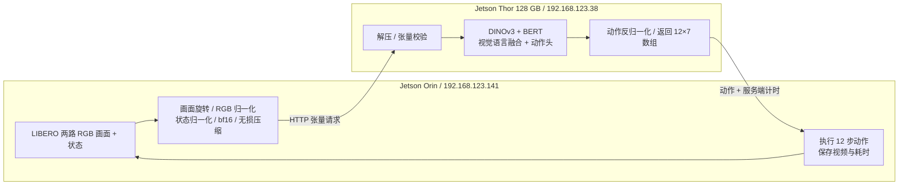

# Orin → Thor → Orin 双设备推理

Orin 从 LIBERO 双路相机获取连续画面，完成图像与机器人状态的预处理，把模型输入发给 Thor。Thor 运行 TurboVLA，返回 12 步、每步 7 维的动作。Orin 执行动作后获取新画面，再次发起请求，形成闭环。这对应“端侧初步计算 → 网络传输 → 边缘神经网络分析 → 返回结果”的两设备结构。



## 分工与切分位置

| Orin | Thor |
| --- | --- |
| LIBERO 仿真、两路画面采集、180° 旋转 | 加载完整 TurboVLA checkpoint |
| 256×256 RGB 校验、DINOv3 输入归一化 | DINOv3、BERT、融合层、动作头的全部神经网络计算 |
| 8 维状态提取与归一化 | 将归一化动作转换为环境动作 |
| 转换至模型精度、无损压缩、发送请求 | 解压与有限值校验、GPU 推理、返回动作 |
| 执行返回动作、输出两份视频和 JSON | 输出可按 request_id 对齐的请求日志 |

这里切在神经网络之前；Orin 不加载 BERT/DINOv3/TurboVLA 权重。图像仍需满足 LIBERO 训练约定：两路、256×256、RGB、正确朝向。随机摄像头视频缺少机器人状态与对应训练场景，不能直接作为 LIBERO 策略控制输入。

预处理配置、状态统计量、模型精度和 checkpoint SHA-256 通过 `/health` 从 Thor 获取。这样两端不会因为统计文件或归一化参数不同而改变动作。BF16 以原始 16 位比特传输，FP32 以 32 位比特传输，使用 zlib 无损压缩，不使用 JPEG 或 pickle。

## 启动 Thor

```bash
cd /home/jetson/LWD/TurboVLA
bash scripts/libero/serve_thor.sh
```

默认使用 `/home/jetson/anaconda3/envs/turbovla/bin/python`，本地 checkpoint、`/home/jetson/models/DINOv3` 和 `/home/jetson/models/bert-base-uncased`。出现 `READY http://192.168.123.38:8765` 后可接收请求。端口已占用时不要重复启动同一服务。

需要后台运行时：

```bash
cd /home/jetson/LWD/TurboVLA
mkdir -p outputs/split
nohup bash scripts/libero/serve_thor.sh > outputs/split/thor_server.log 2>&1 < /dev/null &
echo $! > outputs/split/thor_server.pid
```

停止该后台进程：`kill "$(cat outputs/split/thor_server.pid)"`。前台运行时按 Ctrl+C。代码更新后需要停止旧进程再启动，正在运行的客户端若检测到服务实例变化会报错，需重新运行评估。

可用 `TURBOVLA_PYTHON`、`DINOV3_PATH`、`BERT_PATH`、`THOR_HOST`、`THOR_PORT` 覆盖路径和监听地址；脚本最后的命令行参数也会透传。

## 启动 Orin

```bash
cd /home/nano1/Desktop/lwd/VLA/TurboVLA
bash scripts/libero/run_split_orin.sh
```

默认运行 `libero_spatial` 的 10 个任务，每个 1 回合。仅检查单个任务可以加 `--max_tasks 1`。Orin 只需现有的 `turbovla-libero` 环境和 LIBERO 资产；无需提供本地 checkpoint、DINOv3 或 BERT 路径。

输出位于 `outputs/evaluation/split_thor/`：

- `libero_spatial.json`：任务结果、Thor 身份和 checkpoint 哈希、逐次请求计时。
- `libero_spatial.log`：Orin 评估日志。
- `videos/turbovla_libero/libero_spatial/*.mp4`：20 FPS 的控制步回放。
- 同目录 `*_realtime.mp4`：包含端侧预处理、请求往返和仿真耗时的墙钟回放，等待时显示 `THOR / NETWORK`。

再次使用同一路径会更新同名结果；可用 `SPLIT_OUTPUT=outputs/evaluation/split_run2 bash scripts/libero/run_split_orin.sh` 为下一次运行选择新目录。`THOR_URL`、`LIBERO_ROOT`、`TURBOVLA_PYTHON` 可覆盖默认配置。

原始评估入口同样支持：

```bash
python experiments/libero/evaluate.py \
  --remote_policy_url http://192.168.123.38:8765 \
  --libero_root /home/nano1/Desktop/lwd/VLA/LIBERO \
  --task_suite_name libero_spatial --num_trials_per_task 1 \
  --precision bf16 --chunk_size 12 --num_open_loop_steps 12 \
  --mujoco_gl egl --pyopengl_platform egl \
  --save_video true --save_realtime_video true \
  --result_json_path outputs/evaluation/split_thor/libero_spatial.json
```

省略 `--remote_policy_url` 时，原来的单机本地评估方式仍可用。

## 如何读计时

每次调用仍生成一块 12 步动作。`inference_timings[].duration_s` 是 Orin 观察到的完整策略调用耗时；远程模式下不能把它当作纯模型计算时间。

其 `remote` 字段包含：

| 字段 | 含义 |
| --- | --- |
| `client_preprocess_s` | Orin 图像/状态归一化和精度转换 |
| `client_encode_s` | 输入校验、序列化和无损压缩 |
| `round_trip_s` | HTTP 请求发出至完整响应收到，包含 Thor 的处理时间 |
| `server_decode_s` | Thor 解压、张量重建和校验 |
| `server_queue_s` | 等待模型执行锁 |
| `server_inference_s` | 张量传入 GPU、模型前向、动作传回 CPU 和反归一化 |
| `server_total_s` | 从请求体读完到动作算完，不含 HTTP 收发和响应序列化 |
| `transport_overhead_s` | 往返减服务端总耗时；包含 HTTP、网络与响应处理，不能当作纯网络单向时延 |
| `request_bytes` | 压缩后的 HTTP 请求体字节数，不含 HTTP/TCP 头 |
| `uncompressed_tensor_bytes` | 压缩前张量字节数，bf16 下为 786448 |

两台机器都用各自的单调时钟记录时间间隔，不依赖系统时钟同步。服务启动预热 3 次，预热不在评估计时中；不同指令仍可能有额外首次调用开销。仿真是同步的：等待 Thor 时环境暂停，不模拟实体机器人在推理期间继续运动。

HTTP 服务用于当前局域网，默认底层服务入口监听回环地址，Thor 启动脚本显式监听其局域网 IP。输入尺寸/请求体有上限，支持超时，服务按请求编号回应；断网或无效响应会结束评估，不会悄悄改为 Orin 本地推理。网络与仿真开销都可能抵消 Thor 模型计算的加速，应同时查看完整调用耗时和模型耗时。

## 验证

本地单元测试：

```bash
python -m unittest discover -s tests -v
```

在 Thor 上检查直接推理与 HTTP 路径的一致性（先启动服务）：

```bash
cd /home/jetson/LWD/TurboVLA
/home/jetson/anaconda3/envs/turbovla/bin/python scripts/libero/check_split_parity.py \
  --remote_policy_url http://192.168.123.38:8765 \
  --ckpt_path pretrained/TurboVLA/checkpoints/libero/turbovla_libero.pth \
  --dinov3_path /home/jetson/models/DINOv3 \
  --bert_path /home/jetson/models/bert-base-uncased
```

结果写入 `outputs/split/parity.json`，使用同一 checkpoint 检查 3 组双路画面与状态。跨 Orin/Thor 的完整链路由 Orin 评估 JSON 和 Thor 请求日志中的相同 `request_id` 验证。

## 2026-10-16 实机验收

Orin `192.168.123.141` → Thor `192.168.123.38`，`libero_spatial`、seed 7、bf16、动作块 12、每任务 1 回合：

- 10 回合全部完成，9/10 成功；任务 4 未成功，与 Thor 上原有单机基线逐任务一致。
- 97 次请求全部在 Thor 日志中找到相同的 request_id，服务端记录的客户端 IP 为 Orin 地址。
- 3 组直接推理/HTTP 路径对照的动作完全相同，最大绝对误差为 0。
- 10 份普通回放和 10 份墙钟视频均可解码，帧数与 JSON 时长一致；墙钟视频与实测执行时长的差异均不超过 0.1 秒。
- 两台设备上的 8 项单元测试均通过。Orin 启动命令未提供或加载本地神经网络权重。

| 每次动作块调用（97 次） | 平均 | 中位数 |
| --- | ---: | ---: |
| Orin 完整策略调用 | 189.61 ms | 147.65 ms |
| Orin 预处理 | 7.59 ms | 5.90 ms |
| Orin 校验/编码/压缩 | 18.01 ms | 17.58 ms |
| 请求往返（含 Thor 处理） | 163.77 ms | 122.43 ms |
| Thor 模型推理与动作转换 | 28.97 ms | 28.90 ms |
| 网络/HTTP 等剩余开销 | 131.29 ms | 89.05 ms |

平均请求体约 252 KiB；当前网络传输与 HTTP 开销是端到端时延的重要部分。以上是这次实际运行的观测值，启动预热、设备负载、指令及网络条件都会影响其他运行。

模型 SHA-256：`d031ad7be05a2f5d04afb3194ed26b0cb46083685edee7a5e145078a37d26bab`。Orin 的 `outputs/evaluation/split_thor/` 保留 `libero_spatial.json`、`thor_server.log`、`thor_local_baseline.json`、`parity.json`、`validation.json` 与视频。输出目录按仓库规则忽略，不随源码上传。
